# Project 04/90 — Dockerized Full-Stack Application

Containerizing and deploying a full-stack web application using Docker, Docker Compose, Azure Linux Virtual Machine, and GitHub Actions CI/CD.

## Project Overview

This project demonstrates how to containerize a full-stack application, configure communication between multiple Docker containers, deploy the application to an Azure Linux VM, and automate deployment using GitHub Actions.

The application used for this project is **FlowPilot**, a task and project management application.

**Source Code:** [FlowPilot Repository](https://github.com/saadshah2033-cyber/FlowPilot)

**Live Deployment:** http://20.219.134.32

> Note: The Azure VM may be stopped or deallocated when not in use, so the live deployment may not always be accessible.

## Objectives

- Understand Docker and containerization.
- Create Dockerfiles for frontend and backend services.
- Configure multiple services using Docker Compose.
- Establish communication between containers using Docker networking.
- Persist MongoDB data using Docker volumes.
- Deploy the application to an Azure Linux VM.
- Configure Azure Network Security Group rules.
- Automate deployment using GitHub Actions and SSH.

## Technologies Used

| Category | Technologies |
|---|---|
| Frontend | React, Vite, JavaScript |
| Backend | Node.js, Express.js |
| Database | MongoDB, Mongoose |
| Authentication | JWT, bcrypt |
| Containerization | Docker |
| Container Orchestration | Docker Compose |
| Web Server | Nginx |
| Cloud Platform | Microsoft Azure |
| Operating System | Ubuntu Server 24.04 LTS |
| CI/CD | GitHub Actions |
| Deployment | SSH |

## 1. Project File Structure

The application is organized into separate frontend and backend directories. Docker configuration files are maintained at the project root.

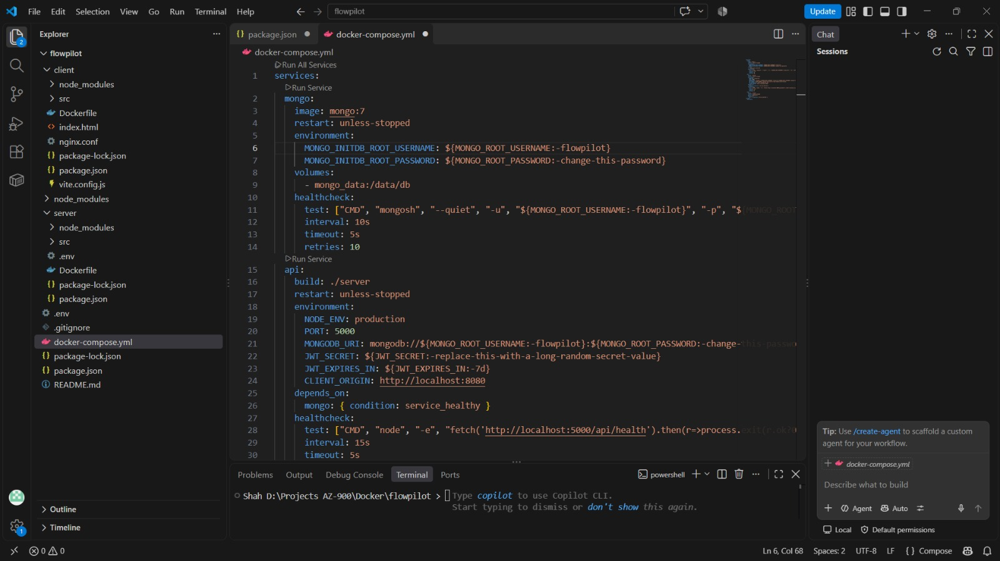

Main components:

- `client/` — React frontend.
- `server/` — Node.js and Express backend.
- `docker-compose.yml` — Defines and manages application services.
- `.env` — Stores environment variables and credentials.
- `.gitignore` — Prevents sensitive and unnecessary files from being committed.
- `.github/workflows/` — Contains the GitHub Actions deployment workflow.

## 2. Docker Compose Architecture

Docker Compose is used to manage three services:

| Service | Responsibility |
|---|---|
| `web` | Serves the React frontend through Nginx |
| `api` | Runs the Node.js and Express backend |
| `mongo` | Stores application data |

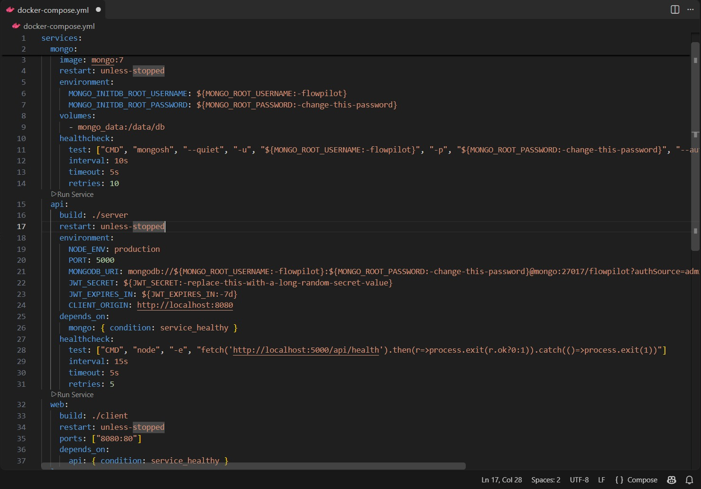

### Application Architecture

```text
                 User Browser
                      |
                      | HTTP :80
                      |
                Azure VM
                      |
                Web Container
                 Nginx
                      |
             /api/ reverse proxy
                      |
                API Container
               Express :5000
                      |
                MongoDB Container
                   :27017
                      |
                 mongo_data
                  Volume
```

The web container is the only service exposed through the VM's public HTTP port. The API and database communicate internally through the Docker network.

## 3. Running Docker Containers

Docker Compose builds and starts all application services together.

Command:

```bash
docker compose up -d --build
```

To inspect running containers:

```bash
docker compose ps
```

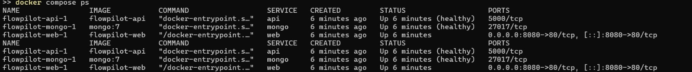

All three services — `web`, `api`, and `mongo` — were successfully started.

## 4. Docker Networking

Docker Compose automatically creates a network that allows services to communicate using their service names.

The application uses internal service communication:

- The frontend communicates with the backend through Nginx.
- The backend connects to MongoDB using the hostname `mongo`.
- MongoDB is not exposed publicly.
- The backend API port is not exposed publicly.

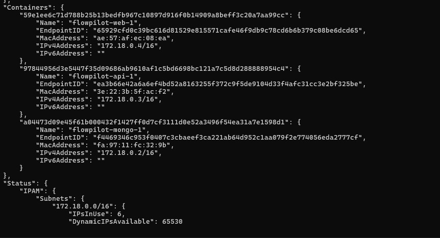

This keeps internal services isolated from direct public access.

## 5. Application Dashboard

After starting the containers, the FlowPilot dashboard was accessed through the browser.

Local application address:

```text
http://localhost
```

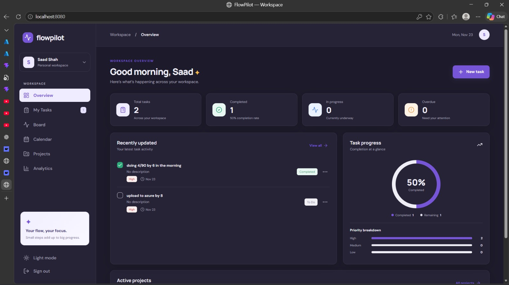

## 6. Application Functionality

The application provides task and project management functionality, including:

- User registration and login.
- Task creation, editing, and deletion.
- Task priorities and status management.
- Due dates and tags.
- Task searching and filtering.
- Kanban board.
- Calendar view.
- Project management.
- Dashboard analytics.
- Light and dark themes.

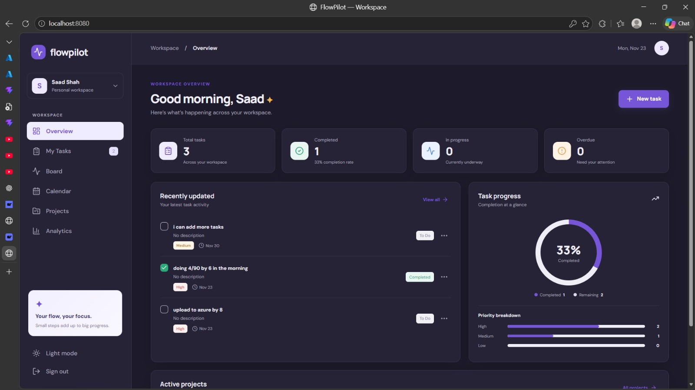

## 7. Task Records

Tasks are stored in MongoDB and associated with their respective users.


The backend uses Mongoose to interact with MongoDB and provides API endpoints for managing application data.

## 8. Project Records

Project records are also stored in MongoDB and used to organize tasks within the application.

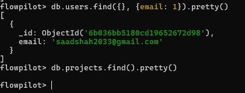

## 9. Docker Installation on Azure VM

An Azure Linux Virtual Machine running Ubuntu Server 24.04 LTS was prepared for deployment.

Docker and the Docker Compose plugin were installed on the VM.

The installation was verified using:

```bash
docker --version
docker compose version
```

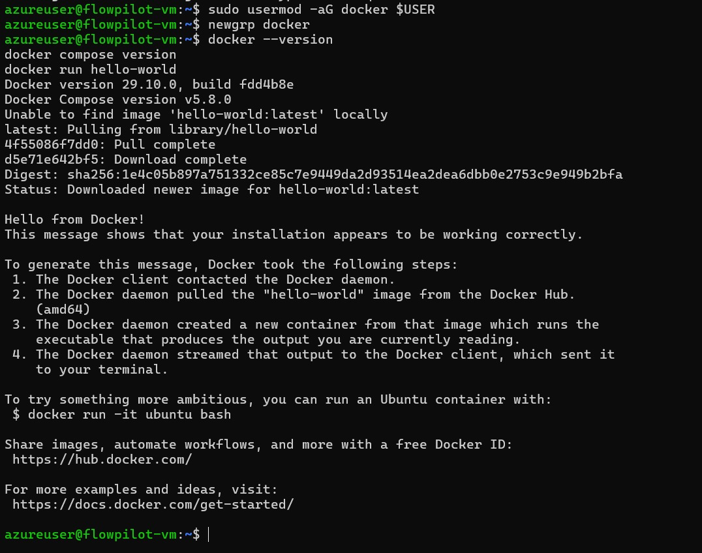

## 10. Application Directory on Azure VM

The FlowPilot repository was cloned onto the Azure VM.

The application directory contains the frontend, backend, Docker configuration, and deployment files.

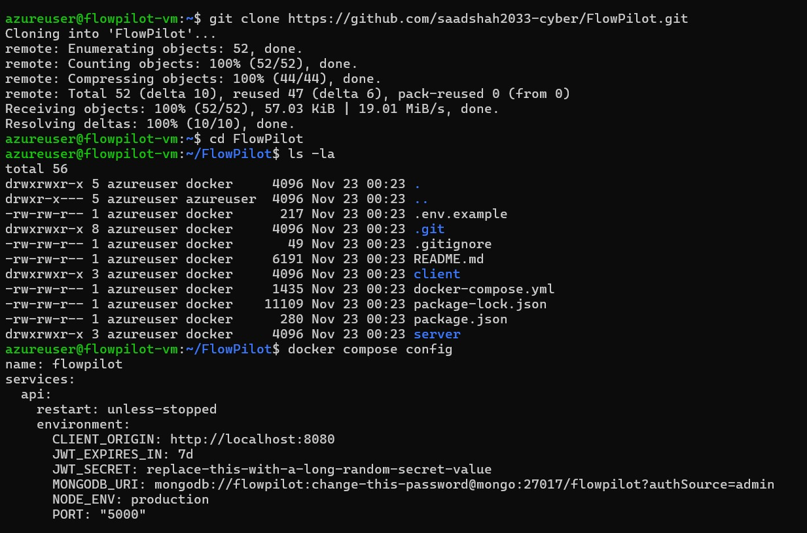

The environment configuration was created separately on the VM. Sensitive credentials were not committed to GitHub.

## 11. Building and Starting the Application on Azure

The application was built and started on the Azure VM using Docker Compose.

```bash
docker compose up -d --build
```

The containers were checked to verify that the services were running.


## 12. Connecting to Azure VM

The Azure Linux VM was accessed securely using SSH.

```bash
ssh -i <private-key-file> azureuser@<VM-PUBLIC-IP>
```

SSH access was configured through the Azure Network Security Group.

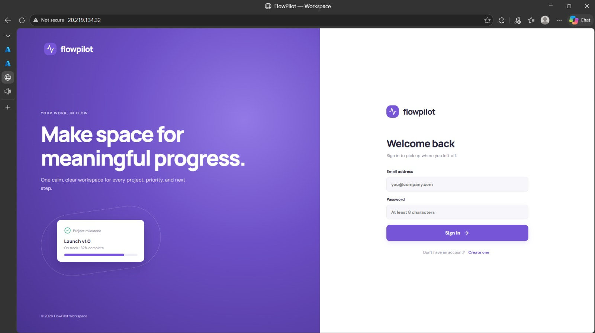

## 13. FlowPilot Dashboard on Azure

After deployment, the application was accessed through the Azure VM's public IP address.

```text
http://20.219.134.32
```

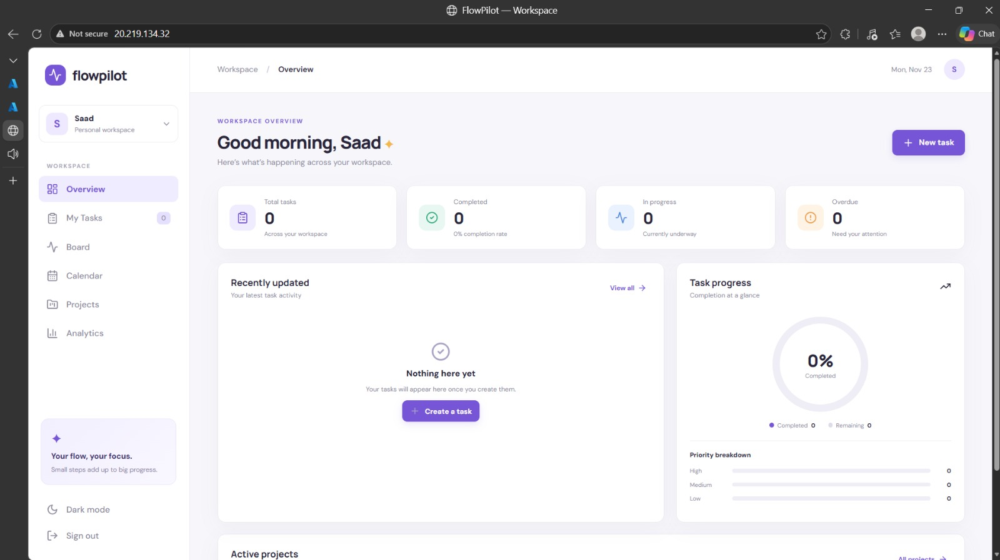

The application was successfully served from the Azure VM using the Nginx web container.

## 14. Testing Deployed Application

The deployed application was tested by logging in and creating tasks through the web interface.

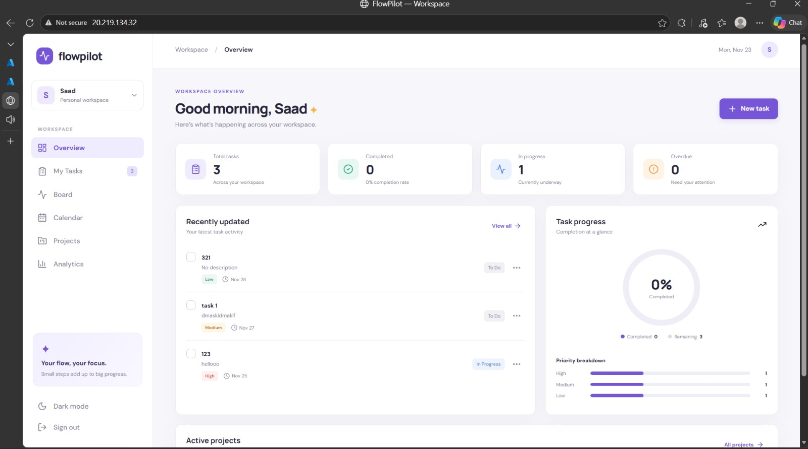

This verified that the frontend, backend API, and MongoDB database were communicating correctly in the cloud deployment.

## 15. GitHub Actions CI/CD Pipeline

A GitHub Actions workflow was configured to automate deployment whenever changes are pushed to the `main` branch.

The workflow connects to the Azure VM through SSH and executes the deployment commands.

### Deployment Workflow

```text
Developer Pushes Code
         |
         v
   GitHub Repository
         |
         v
   GitHub Actions
         |
         v
      SSH Login
         |
         v
      Azure VM
         |
         v
      Git Pull
         |
         v
 Docker Compose Build
         |
         v
   Updated Application
```

### Workflow Configuration

The deployment workflow performs the following operations:

1. Triggers on pushes to `main`.
2. Connects to the Azure VM using SSH.
3. Navigates to the application directory.
4. Pulls the latest changes from GitHub.
5. Rebuilds and restarts the Docker Compose services.
6. Checks the running containers.

GitHub repository secrets are used to store deployment credentials:

| Secret | Purpose |
|---|---|
| `AZURE_HOST` | Azure VM public IP |
| `AZURE_USER` | VM username |
| `AZURE_SSH_KEY` | Private SSH key |

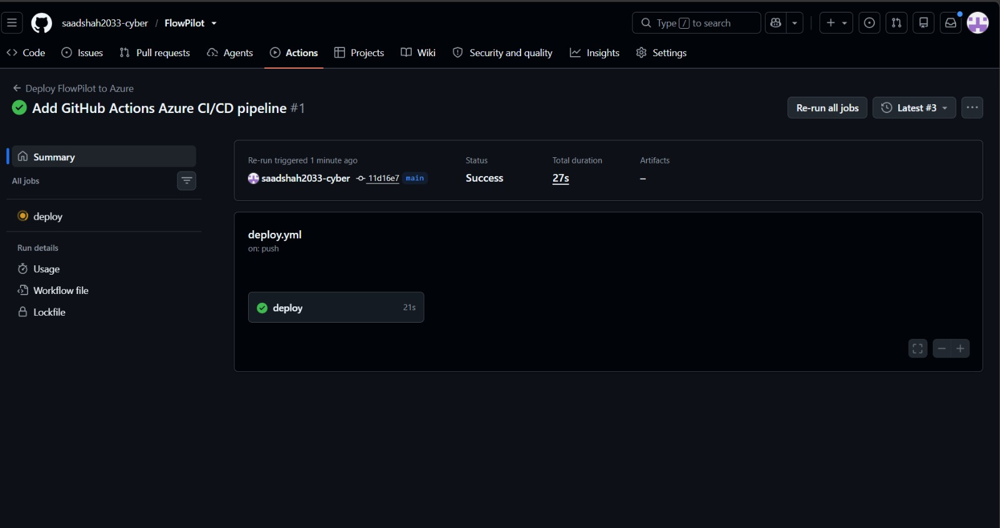

The GitHub Actions workflow completed successfully, confirming that automated deployment was working.

## Challenges and Solutions

| Challenge | Solution |
|---|---|
| Container-to-container communication | Used Docker Compose service names and networking |
| Database persistence | Configured a named Docker volume |
| Service startup order | Used Docker health checks and service dependencies |
| Secure VM access | Configured SSH key authentication |
| Public application access | Configured Azure NSG rules for HTTP |
| GitHub Actions SSH authentication | Corrected the private key secret configuration |
| Automated deployment | Created a GitHub Actions workflow using SSH |

## Key Learnings

Through this project, I gained practical experience with:

- Containerizing frontend and backend applications.
- Writing and managing Dockerfiles.
- Running multi-container applications using Docker Compose.
- Configuring Docker networks and persistent volumes.
- Managing environment variables and application secrets.
- Deploying containerized applications on Azure Linux VMs.
- Configuring secure SSH access and network rules.
- Implementing automated deployments using GitHub Actions.
- Troubleshooting container and CI/CD deployment issues.

## Future Improvements

- Configure HTTPS using SSL/TLS.
- Implement automated application tests in the CI/CD pipeline.
- Add centralized logging and monitoring.
- Configure automated database backups.
- Improve SSH and network security.

## Project Information

**Project:** 04/90 — Dockerized Full-Stack Application

**Cloud Platform:** Microsoft Azure

**Deployment Method:** Docker Compose + GitHub Actions CI/CD

**Application Repository:** https://github.com/saadshah2033-cyber/FlowPilot

**Status:** Completed
